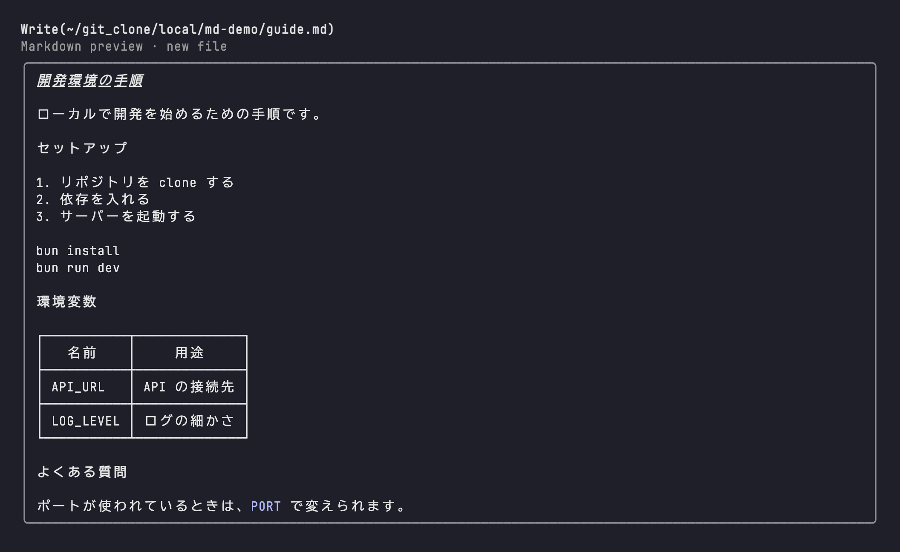
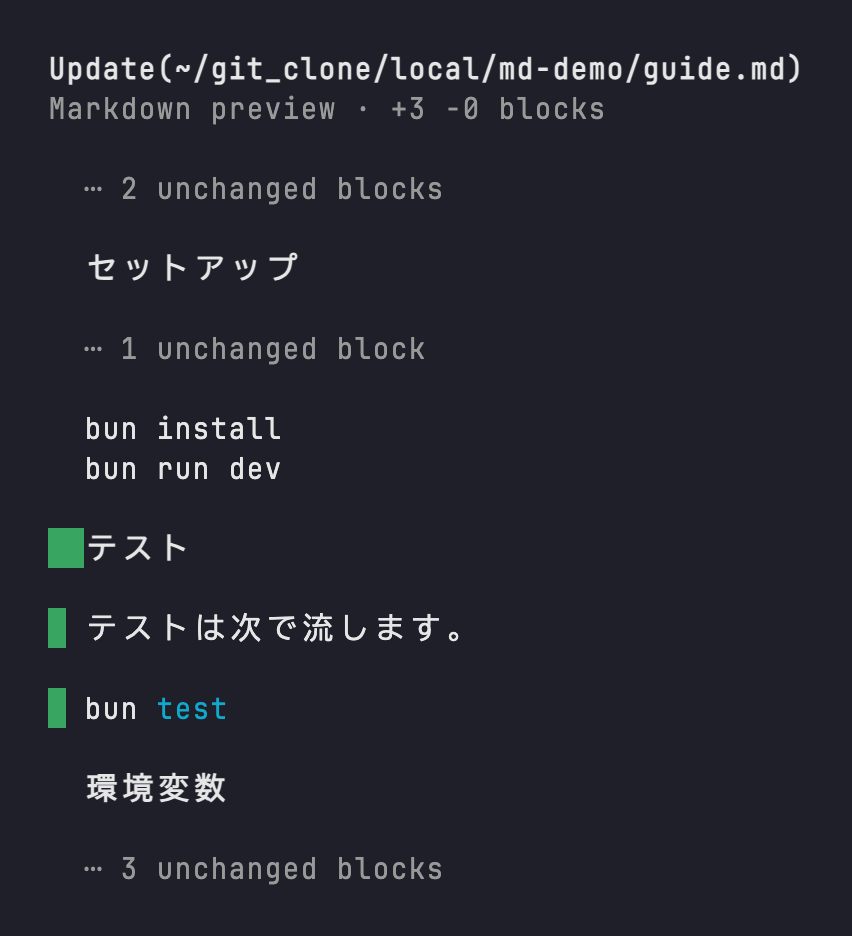
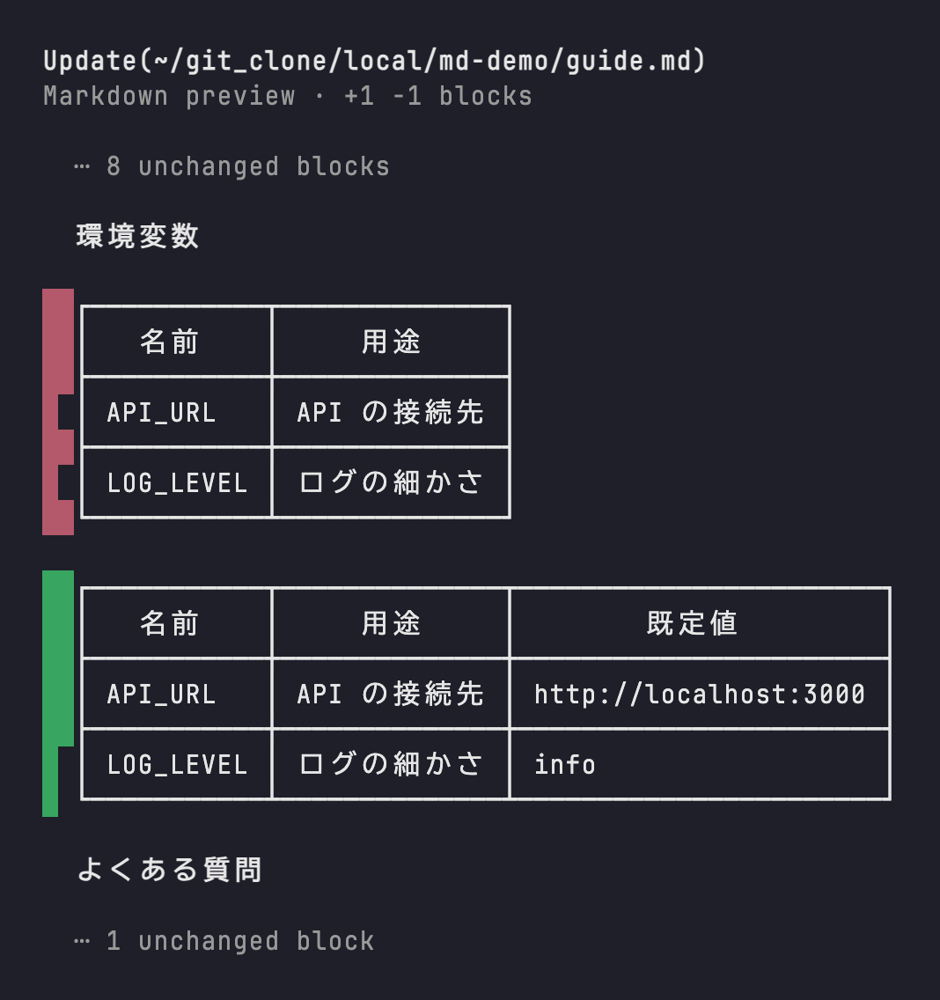
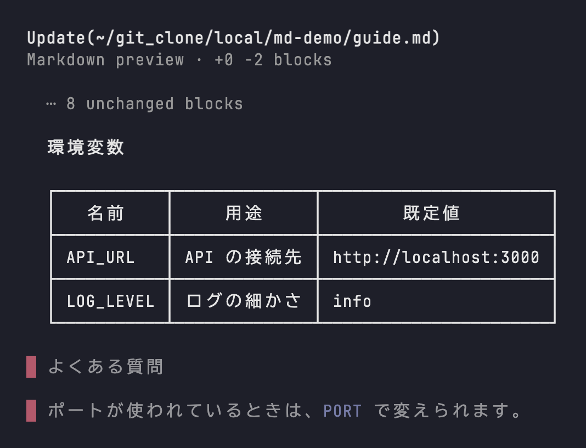

# md-diff-preview

Claude が Write / Edit で Markdown（`.md` / `.mdx` / `.markdown`）を書き換えたとき、会話欄に出る diff の代わりに、GitHub の rich diff のような整形済みの差分を見せる Claude Code の mod（hooks モジュールだけのプラグイン）。

- 文書を見出し・段落・リスト・表・コードブロックのブロックに分けて比べ、削除したブロックは左に赤の帯（本文は薄く）、足したブロックは緑の帯で描く
- 変わったブロックには、属する見出しと前後 1 ブロックを文脈として添え、残りは「⋯ N unchanged blocks」に畳む。最大 80 行
- 新規作成は文書全体を、編集前の全文が分からないときは変更した行を含む節を、帯なしで整形して見せる
- ctrl+o でも diff には戻らない（端末は Edit の行を常に全表示として渡すので、ctrl+o を見分けられない）
- 書き込み前の承認ダイアログの diff は置き換えられない（エンジンだけが描く）

## 表示例

| 新規作成 | 追加 |
| --- | --- |
|  |  |

| 変更 | 削除 |
| --- | --- |
|  |  |

## 読み込まれ方

chezmoi が `~/.claude/skills/md-diff-preview/` に配り、Claude Code が skills フォルダのプラグインとして起動時に読み込む。`settings.json` は触らない。変更は `scripts/apply-merged.sh` で配った後、セッションを開き直すと効く。

## テスト

```
claude plugin validate ~/.claude/skills/md-diff-preview
claude plugin test ~/.claude/skills/md-diff-preview
```
